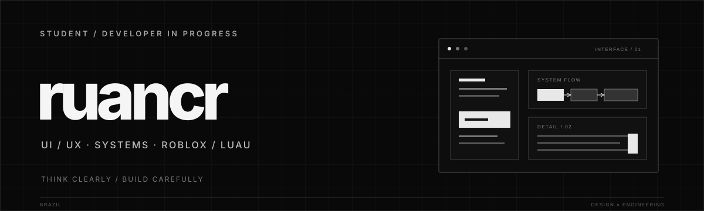

<table>
  <tr>
    <td width="68%" valign="middle">
      
ESTUDANTE &nbsp;·&nbsp; DESENVOLVIMENTO

      <h1>Entre interfaces e sistemas.</h1>
      
Gosto de criar coisas digitais e entender as duas partes de um projeto: o que a pessoa vê e usa, e a lógica que faz tudo funcionar.

      
<strong>UI/UX &nbsp;·&nbsp; Sistemas &nbsp;·&nbsp; Roblox / Luau</strong>

    </td>
    <td width="32%" align="center" valign="middle">
      
    </td>
  </tr>
</table>

---

## O que me interessa

<table>
  <tr>
    <td width="50%" valign="top">
      
01 &nbsp; / &nbsp; EXPERIÊNCIA

      <h3>UI / UX</h3>
      
Como uma interface comunica, orienta e responde. Gosto de observar hierarquia visual, navegação, consistência e pequenos detalhes de interação.

    </td>
    <td width="50%" valign="top">
      
02 &nbsp; / &nbsp; FUNCIONAMENTO

      <h3>Sistemas</h3>
      
Como as partes se conectam: regras, estados, dados e mecânicas. Tenho interesse especial em sistemas de gameplay e experiências multiplayer no Roblox.

    </td>
  </tr>
</table>

## Ferramentas que uso

| Desenvolvimento | Ferramentas |
|:--|:--|
| **Luau** · JavaScript · TypeScript | Roblox Studio · VS Code |
| **HTML** · CSS · Python | GitHub · Supabase · Netlify |
| | Google AI Studio |

## Estudando agora

Aprofundando Luau, organização de sistemas client/server e persistência de dados, enquanto estudo formas de criar interfaces mais claras e consistentes.

---

Um espaço para experiências, estudos e projetos em construção.
